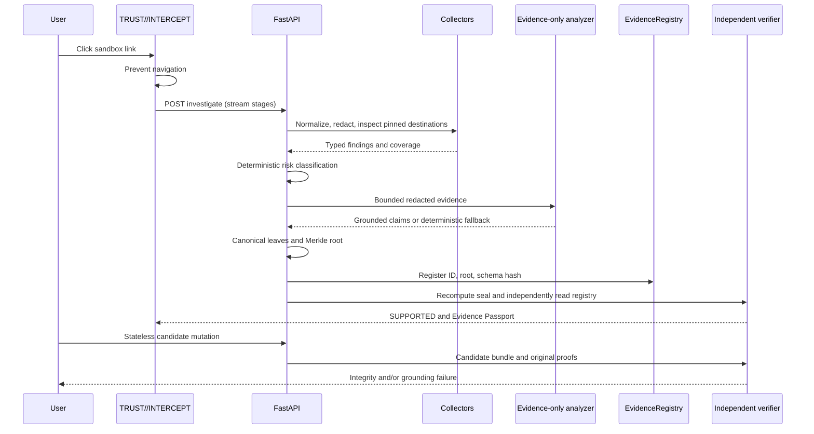

# VERIDICT

**Evidence before trust.** TRUST//INTERCEPT pauses navigation, investigates a destination, and turns the findings into a SEALED//EVIDENCE Passport. Every explanation cites evidence; a Merkle commitment makes alterations independently detectable.

Blockchain records integrity and history, **never truth or safety**. The internal schema remains `sealed-evidence/1`.

## Start the complete stack

Prerequisites: a running Docker Desktop/Linux engine with Compose and network access for the initial dependency/image download.

```sh
docker compose up --build
```

Open **http://localhost:3000**. API documentation: **http://localhost:8000/docs**. No API keys, wallet, browser extension, or external target is needed for the six fixtures.

Compose starts Hardhat, deploys EvidenceRegistry, starts FastAPI with SQLite, then starts the standalone Next.js production server. Host ports bind to loopback. The frontend's API proxy reads `BACKEND_URL` at runtime.

`LIVE_CHECKS=false` is the default. Fixtures always use explicitly labeled deterministic adapters. Custom URLs run available local checks; unavailable mandatory collectors remain incomplete, producing `INCONCLUSIVE` unless a risk indicator fires. Once dependencies and images are cached, the running fixture demo needs no external service.

Stop containers without deleting SQLite data:

```sh
docker compose down
```

Hardhat's development ledger resets when its container restarts. Old SQLite reports remain historical records, but missing original anchors return 503. Create new reports after restarting the chain. The development chain is not durable production storage.

## Native development

Use Node 24, Python 3.12, uv, npm, and pnpm 11.24.0. The stack is Hardhat 3, Solidity 0.8.38, OpenZeppelin 5.x, Next.js 16.4 and React 19. Lockfiles pin dependency versions; the npm-installed Solidity compiler avoids a separate compilation-time download.

From the repository root:

```sh
npm ci --prefix contracts
uv sync --directory backend --python 3.12 --frozen
pnpm --dir frontend install --frozen-lockfile
```

Windows PowerShell can use `.cmd` launchers without changing execution policy. If uv is absent, bootstrap it locally:

```powershell
python -m pip install --target .tools uv
.\.tools\bin\uv.exe sync --directory backend --python 3.12 --frozen
npm.cmd ci --prefix contracts
pnpm.cmd --dir frontend install --frozen-lockfile
```

Use four terminals, each initially at the repository root:

```sh
# Terminal 1
cd contracts
npx hardhat node --hostname 127.0.0.1
```

```sh
# Terminal 2, once the node is ready
npm --prefix contracts run deploy
```

```sh
# Terminal 3
uv run --directory backend uvicorn app.main:app --host 127.0.0.1 --port 8000 --no-access-log
```

```sh
# Terminal 4
pnpm --dir frontend dev
```

On PowerShell use `npm.cmd`, `npx.cmd`, `pnpm.cmd`, and `.\.tools\bin\uv.exe` in place of global equivalents. Deployment writes ignored `runtime/deployment.json`. Native `CHAIN_MODE=auto` selects the reachable registry at startup; `evm` requires it, and `fixture` explicitly selects memory. An adapter never changes during a running backend process.

The simulated adapter verifies against an independent process-local anchor map, not the report's self-reported root. Receipts have `mode: fixture`, `network: fixture-memory`, and null transaction/block/contract fields. `/health` reports `chain_connected: false`. These anchors disappear on process restart; the UI labels them prominently.

## Architecture



| Boundary | Responsibility |
|---|---|
| Collectors | Validate every DNS answer, pin socket IPs, preserve Host/SNI, revalidate redirect hops, inspect certificates and intelligence |
| Privacy | Strip credentials/fragments, mask secret URL values and PII, retain redacted message spans and hashes |
| Risk | Own five-state classification; missing checks cannot imply safety |
| Analyzer | Explain supplied evidence with valid IDs/type gates; no tools or risk assignment |
| Sealer | Commit evidence, claims, coverage, and every remaining bundle field |
| Registry | Store ID, root, schema hash, timestamp; reject duplicates and zero roots |
| Verifier | Fetch original anchor, recompute candidate root, check original proofs and grounding |
| UI | Keep navigation blocked, show provenance and coverage, expose verification and reversible mutations |

### Cryptographic contract

Canonical JSON uses the exact specified `json.dumps(sort_keys=True, separators=(",", ":"), ensure_ascii=False, allow_nan=False)` UTF-8 serializer. This is the specified deterministic subset, **not full RFC 8785 numeric or Unicode-key normalization**. Typed collection fields avoid floating-point measurements.

```text
schemaHash = keccak256(utf8("sealed-evidence/1"))
leaf = keccak256(abi.encode(keccak256(utf8(type)), keccak256(canonical_json(full_object))))
parent = keccak256(min(a,b) || max(a,b))
```

Sort evidence by ASCII ID, then sorted claims, `cov:1`, and `meta:1`. Promote odd trailing nodes without duplication/self-hashing. Metadata commits schema, report ID, creation time, redacted URL, risk, collection/analyzer provenance, social indicators, and limitations. Hashes use lowercase `0x` plus 64 hex digits; the primitive verifier accepts equivalent casing and safely rejects malformed input.

Python-generated vectors are checked with Ethers ABI encoding and an OpenZeppelin `MerkleProof` harness. Seed interfaces and assertions are preserved.

### Risk and verification precedence

1. `CONFIRMED_MALICIOUS`: complete confirmed intelligence hit, or confirmed protected-domain impersonation with invalid TLS and credential-harvesting indicators.
2. `HIGH_RISK`: typosquat/homograph alone; brand impersonation with credential, redirect or hostname/expiry corroboration; or blocked SSRF.
3. `SUSPICIOUS`: certificate anomalies, more than two cross-domain redirects, redirect loops/limit exhaustion, urgency with a specified abuse TLD, or obfuscation.
4. `INCONCLUSIVE`: no higher trigger and an unavailable/incomplete mandatory check.
5. `LOW_RISK`: no higher trigger and complete URL, TLS, OpenPhish and redirect coverage.

Optional unconfigured Safe Browsing does not invalidate complete OpenPhish coverage. Failed/timed-out intelligence has `matched: null`, never a fabricated negative.

Verifier status precedence is `NOT_SUPPORTED` for grounding failure, otherwise `TAMPERED` for root/schema/original-proof failure, otherwise `SUPPORTED`. Independent fields expose `root_match`, `claim_grounding`, `schema_match`, `target_leaf_valid`, failure reasons and per-leaf validity. Deleting threat intelligence returns `NOT_SUPPORTED` **and** `root_match: false`.

Unmodified leaves retain valid original proofs when another leaf changes. Array order is canonicalized by ID; duplicate/reserved IDs are rejected. Tampering deep-clones the genuine report and never changes SQLite or registers a new root. Reset reloads and freshly verifies it.

## API contracts

| Method | Route | Input / result |
|---|---|---|
| POST | `/api/investigate` | `{url, message?, fixture_id?}` → `{bundle, merkle, chain_receipt, verification}` |
| GET | `/api/fixtures` | Six labeled cases with redacted pre-populated inputs |
| GET | `/api/reports/{id}` | Stored report; initial verification is historical |
| POST | `/api/reports/{id}/verify` | `{evidence_id?, candidate_bundle?}` → fresh independent verification |
| POST | `/api/reports/{id}/tamper-demo` | `{mutation, evidence_id?}` → candidate bundle/Merkle data, verification and root diff |
| GET | `/health` | Service status, registry connectivity, address and adapter mode |

Mutations: `tls_cert`, `drop_threat_intel`, `alter_redirect`, `unground_ai_claim`. A fixture request must match its configured destination; it cannot attest to an arbitrary URL.

JSON is the default. `Accept: text/event-stream` on the investigation POST emits actual `stage` events (`url`, `redirects`, `tls`, `threat_intel`, `ai`, `seal`), then a complete `report` or sanitized `error`. Progress is not a timer simulation; errors keep navigation blocked.

Sanitized invalid-input responses return 422; absent reports/fixtures return 404; unavailable/lost original anchors return 503. The UI requests fresh verification before presenting current assurance.

Pydantic models are the contract source. Regenerate schemas/types after changes:

```sh
uv run --directory backend python scripts/export_openapi.py
pnpm --dir frontend schema:generate
```

## Optional live services

Copy `.env.example` to `.env` for Compose, or export settings before native startup. Keys stay server-side.

| Setting | Default / behavior |
|---|---|
| `LIVE_CHECKS` | `false`; `true` enables actual network collection |
| `CHAIN_MODE` | Native `auto`; Compose `evm`; explicit `fixture` selects memory |
| `RPC_URL`, `CONTRACT_ADDRESS`, `DEPLOYMENT_PATH` | Select registry; deployment metadata supplies its address |
| `CHAIN_PRIVATE_KEY` | Unneeded for unlocked local Hardhat; required outside chain 31337 |
| `DATABASE_PATH` | Ignored `runtime/veridict.db` or Compose volume |
| `OPENPHISH_CACHE_PATH` | Cached redacted OpenPhish Community Feed, refreshed when stale during live collection |
| `OPENPHISH_CACHE_MAX_AGE` | 86400 seconds; unavailable/stale-feed failures remain unknown |
| `GOOGLE_SAFE_BROWSING_KEY` | Optional v5 provider; unset means `UNCONFIGURED` |
| `OPENAI_API_KEY`, `OPENAI_MODEL` | Both required for evidence-only Responses API; otherwise deterministic synthesis |
| `BACKEND_URL` | Runtime frontend proxy target; default `http://127.0.0.1:8000` |
| `CORS_ORIGINS` | Explicit localhost/loopback development origins |

OpenAI uses strict structured output, no tools, bounded complete evidence JSON, independent validation, one retry, then deterministic synthesis. Live credentials/billing are not exercised by offline acceptance tests. See [official structured-output documentation](https://developers.openai.com/api/docs/guides/structured-outputs?api-mode=responses).

Safe Browsing is optional and subject to provider terms and non-commercial restrictions. It can produce false positives and false negatives. Google attribution accompanies its evidence only. See [API reference](https://developers.google.com/safe-browsing/reference/rest/v5/urls/search) and [usage restrictions](https://developers.google.com/safe-browsing/v4/usage-limits).

## Threat model and limits

- **SSRF/rebinding:** every resolved address must be public. Connections use validated numeric IPs, original Host/SNI and peer checks. Every redirect is revalidated; environment proxies are disabled. Private, loopback, link-local, metadata, multicast, reserved and mapped-private IPv6 addresses are blocked.
- **Bounded inspection:** HEAD-only redirects, three-second per-hop deadlines, four redirects maximum, loop detection, no script execution/downloads. An unverified TLS reconnect retrieves certificate bytes only and sends no HTTP application request.
- **Privacy:** submitted messages remain transient; only selected pattern spans, offsets/hashes and redacted excerpts enter reports. Known URL secrets and PII are removed before evidence, persistence and AI submission. Access logging is disabled. Redaction is heuristic; avoid real credentials. Destinations can change after inspection.
- **Untrusted content:** URLs/messages cannot invoke tools or set risk. Semantic type-gating checks appropriate evidence categories; it does not prove natural-language truth.
- **Tampering:** roots cover metadata and all evidence/AI content. Proofs and independently fetched anchors detect changes. Valid passports do not certify collector honesty or exhaustive coverage.
- **Local boundary:** no authentication, multi-tenant isolation or production rate limiter. Do not expose the MVP or unlocked Hardhat RPC to the internet. The gate governs its own sandbox links; fixture destinations never open.
- **Durability:** investigations are historical snapshots. Public-chain finality, registry authorization, revocation, distributed persistence and a production browser extension are outside this MVP. Redacted SQLite data still deserves normal access controls.

Contract development dependencies have a remaining upstream security limit: `npm audit --prefix contracts` reports 17 findings (13 high), primarily inherited through Hardhat's Zod 3 dependency and Mocha's dependency graph. Scoped overrides patch `tmp` and `serialize-javascript` while retaining Solidity 0.8.38. Compatible `npm audit fix` did not resolve the remaining findings; forcing incompatible toolchain upgrades was avoided. Keep the development RPC local and review these dependencies before wider deployment.

## Verification gates

From the repository root:

```sh
npm --prefix contracts test
uv run --directory backend pytest
uv run --directory backend python scripts/export_openapi.py --check
pnpm --dir frontend schema:check
pnpm --dir frontend typecheck
pnpm --dir frontend lint
pnpm --dir frontend build
pnpm --dir frontend exec playwright install chromium
pnpm --dir frontend test:e2e
```

Browser tests run the standalone production server and a fixture backend. They check interception, every mutation/reset, deep links, citation highlighting, offline/private destinations, service failure and mobile overflow. Screenshots are captured under ignored `frontend/test-results/`.

With the real local EVM stack running:

```sh
uv run --directory backend python scripts/rehearse.py --require-evm
```

This creates six reports, checks verdicts, exercises 24 mutations and six resets, and reads every registered root/schema/timestamp directly from the contract independently of the API. CI runs all gates and Compose startup/rehearsal.

## 90-second judge walkthrough

| Time | Action and point |
|---|---|
| 0–15s | Click **suspicious-1**. Show navigation blocked, actual inspection stages and confirmed-feed verdict. |
| 15–30s | Open Passport. Point to coverage/provenance. Click a claim's evidence ID to highlight its leaf. |
| 30–45s | Verify independently: `SUPPORTED`. Show registered root, real local EVM receipt and canonical payload/proof. |
| 45–60s | Mutate TLS: `TAMPERED`. Delete intelligence: `NOT_SUPPORTED` and integrity failure. |
| 60–75s | Reset, alter a redirect, inject a missing evidence ID, then reset. Stored evidence never changes. |
| 75–90s | Open **benign-1** (`LOW_RISK`), then **benign-3** (`INCONCLUSIVE`). Close: “We make the evidence behind a security decision independently auditable.” |

See [IMPLEMENTATION_PLAN.md](IMPLEMENTATION_PLAN.md) for traceability, resolved integration decisions and gate results.
